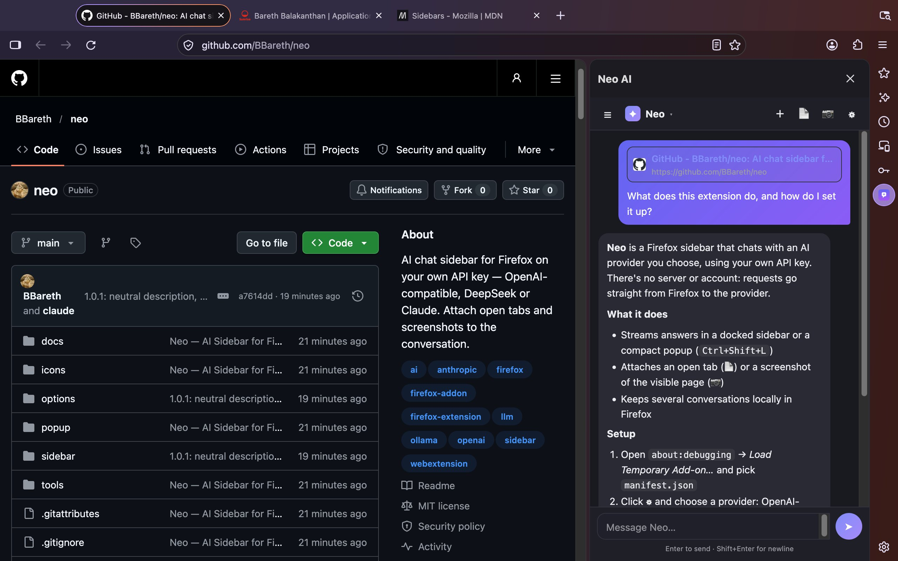
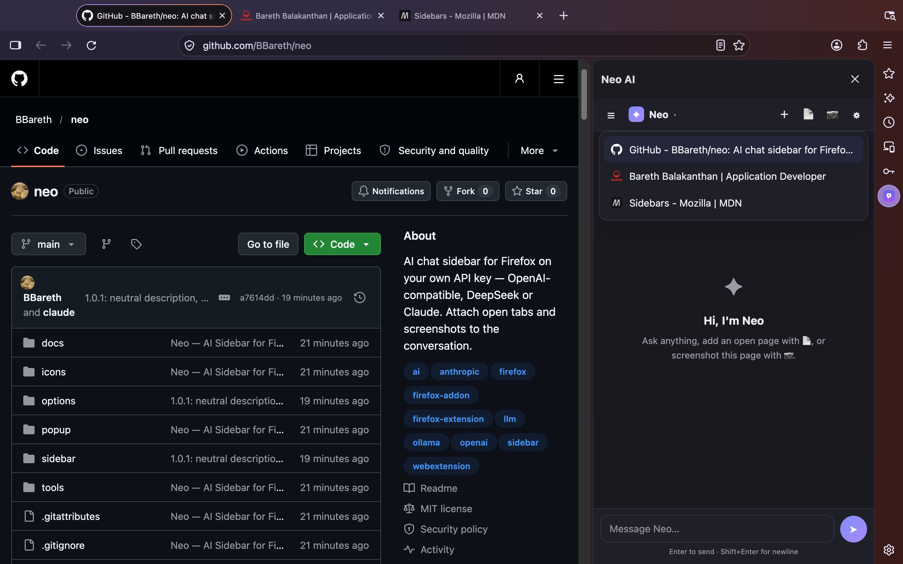
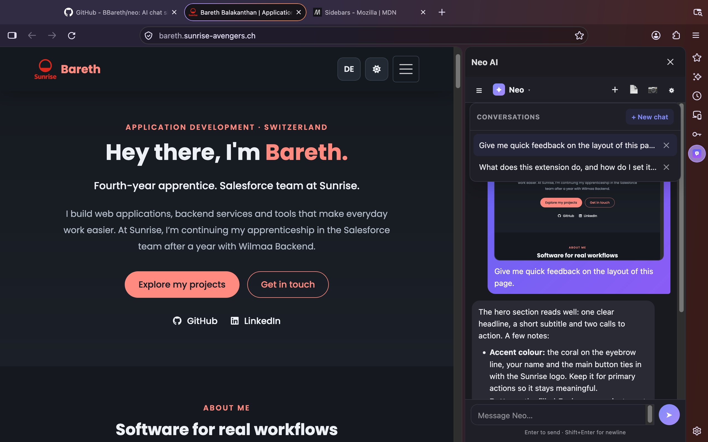
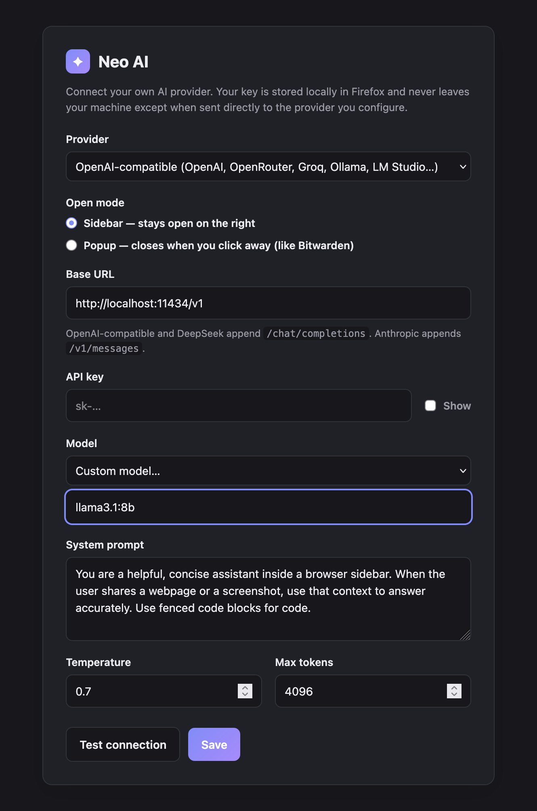

<p align="center">
  
</p>

<h1 align="center">Neo — AI Sidebar</h1>

<p align="center">
  An AI chat sidebar for Firefox that runs on your own API key —
  OpenAI-compatible, DeepSeek or Claude. Drop open tabs and screenshots
  straight into the conversation.
</p>

<p align="center">
  <a href="./LICENSE"></a>
  
  
  
</p>

<p align="center">
  
</p>

---

Press `Ctrl+Shift+L`, ask a question, get a streamed answer in a panel on the
right. Neo has no server, no account and no subscription: it sends your
messages straight from Firefox to the provider you configure, with the key you
paste in, and keeps everything else on your machine.

- **Bring your own AI.** Any OpenAI-compatible endpoint (OpenAI, OpenRouter,
  Groq, Ollama, LM Studio, …), DeepSeek, or Anthropic. Pick a model from the
  list or type any model name your provider supports.
- **Talk about what you're looking at.** The 📄 button lists your open tabs;
  pick one and its title, URL, description and page text are attached to your
  next message. Or right-click a page or a selection → **Neo AI**.
- **Show, don't describe.** The 📷 button screenshots the visible part of the
  current tab and sends it to a vision-capable model.
- **Sidebar or popup.** Keep Neo docked as a Firefox sidebar, or switch to a
  compact popup that closes when you click away. The same shortcut opens
  either.
- **Many conversations.** Create, switch between and delete chats. They're
  stored locally in Firefox and survive restarts.
- **Readable answers.** Streaming responses rendered as sanitized Markdown:
  code blocks, headings, lists, links.
- **Small and dependency-free.** Plain HTML, CSS and JavaScript — about 1,300
  lines, no framework, no bundler, nothing minified. What's in the repo is
  exactly what ships.

## Screenshots

| | | |
| --- | --- | --- |
|  |  |  |
| **📷 Screenshot** the visible page and ask about it | **📄 Attach** any open tab | **☰ Conversations**, stored locally in Firefox |

<sub>Captured in Firefox 159 against a local mock of an OpenAI-compatible
endpoint, so the replies shown are scripted.</sub>

> [!IMPORTANT]
> Anything you send — including pages and screenshots you attach — goes to
> **the provider you configure** and is subject to their terms and privacy
> policy. Neo never reads a page or takes a screenshot unless you click the
> button. See [PRIVACY.md](./PRIVACY.md).

## Install

### From Firefox Add-ons

_Coming soon — pending review on [addons.mozilla.org](https://addons.mozilla.org/)._

### From source (temporary)

1. Clone this repository:
   ```bash
   git clone https://github.com/BBareth/neo.git
   ```
2. In Firefox, open `about:debugging#/runtime/this-firefox`.
3. Click **Load Temporary Add-on…** and select `manifest.json` in the cloned
   folder.
4. The **Neo** toolbar button appears. Click it, or press `Ctrl+Shift+L`.

Temporary add-ons are removed when Firefox restarts.

## Set up your AI

1. Click ⚙ in the sidebar header (or `about:addons` → **Neo — AI Sidebar** →
   **Preferences**).
2. Choose a **Provider** and check the **Base URL**:

   | Provider | Base URL | Request goes to |
   | --- | --- | --- |
   | OpenAI | `https://api.openai.com/v1` | `…/chat/completions` |
   | OpenRouter | `https://openrouter.ai/api/v1` | `…/chat/completions` |
   | Groq | `https://api.groq.com/openai/v1` | `…/chat/completions` |
   | Ollama (local) | `http://localhost:11434/v1` | `…/chat/completions` |
   | LM Studio (local) | `http://localhost:1234/v1` | `…/chat/completions` |
   | DeepSeek | `https://api.deepseek.com` | `…/chat/completions` |
   | Anthropic | `https://api.anthropic.com` | `…/v1/messages` |

3. Pick a **Model** (or **Custom model…** to type one), paste your **API
   key**, and optionally tune the system prompt, temperature and max tokens.
4. Press **Test connection**, then **Save**.
5. Choose an **Open mode**: **Sidebar** (stays docked on the right) or
   **Popup** (closes when you click away).

Screenshots need a vision-capable model, such as `gpt-4o` or any current
Claude model.

<p align="center">
  
</p>

## Usage

| Action | How |
| --- | --- |
| Open / close Neo | Toolbar button, or `Ctrl+Shift+L` (`⌘+Shift+L` on macOS) |
| New chat | ＋ in the header |
| Switch or delete chats | ☰ or the **Neo ▾** title |
| Attach an open tab | 📄, then pick the tab |
| Attach a screenshot | 📷 (captures the visible part of the active tab) |
| Attach the current page | Right-click the page → **Add this page to Neo AI** |
| Ask about a selection | Select text, right-click → **Ask Neo AI about the selection** |
| Send / new line | `Enter` / `Shift+Enter` |

To change the shortcut: `about:addons` → gear icon → **Manage Extension
Shortcuts**.

## Permissions

| Permission | Why Neo needs it |
| --- | --- |
| `storage` | Save your settings and conversations locally. |
| `tabs` | List open tabs in the 📄 picker and find the active tab. |
| `scripting`, `activeTab`, `<all_urls>` | Read the text of a page you choose to add, capture screenshots, and reach whatever API endpoint you configure. |
| `menus` | The right-click **Neo AI** items. |

Neo declares its data handling with Firefox's built-in data consent: it
transmits your messages, and the page content you attach, to the provider you
configure. Nothing is sent anywhere else. Full details in
[PRIVACY.md](./PRIVACY.md).

## How it works

```
 toolbar / Ctrl+Shift+L ──> background.js ──> sidebar  (or popup, per settings)
 right-click menu ────────> background.js ──> storage.local "pendingContext" ──> sidebar

 sidebar.js ── 📄 scripting.executeScript ──> page title, URL, description, text (≤ 8,000 chars)
            ── 📷 tabs.captureVisibleTab ───> JPEG data URL
            ── fetch (SSE stream) ─────────> your provider ──> streamed reply, rendered as Markdown
```

The sidebar and the popup are the same page (`sidebar.js`) with different
styles. The background script only switches the toolbar button between
"toggle sidebar" and "open popup", and passes right-click context to the UI
through `browser.storage.local`, so nothing is lost if the sidebar is still
loading. Settings, conversations and attachments all live in
`browser.storage.local`.

```
manifest.json          extension manifest (MV3)
background.js          toolbar / shortcut handling, open mode, context menus
sidebar/               chat UI: conversations, attachments, streaming, Markdown
popup/                 the same UI sized as a popup
options/               provider, model and API key settings
icons/                 extension icons
tools/make_icons.py    icon generator (Pillow)
```

## Development

No build step. Load `manifest.json` as a temporary add-on (see
[Install](#from-source-temporary)), edit, then press **Reload** on
`about:debugging`.

With [web-ext](https://extensionworkshop.com/documentation/develop/getting-started-with-web-ext/)
(Node 18+):

```bash
npx web-ext run                       # launch a clean Firefox with Neo loaded, auto-reloads on save
npx web-ext lint                      # run Mozilla's add-on linter
npx web-ext build --overwrite-dest    # package to web-ext-artifacts/*.zip for AMO
```

`web-ext` reads [`web-ext-config.mjs`](./web-ext-config.mjs), which keeps the
repo's docs and tooling out of the package.

Regenerate the icons (needs Pillow):

```bash
python tools/make_icons.py
```

## Licence

MIT — see [LICENSE](./LICENSE).
